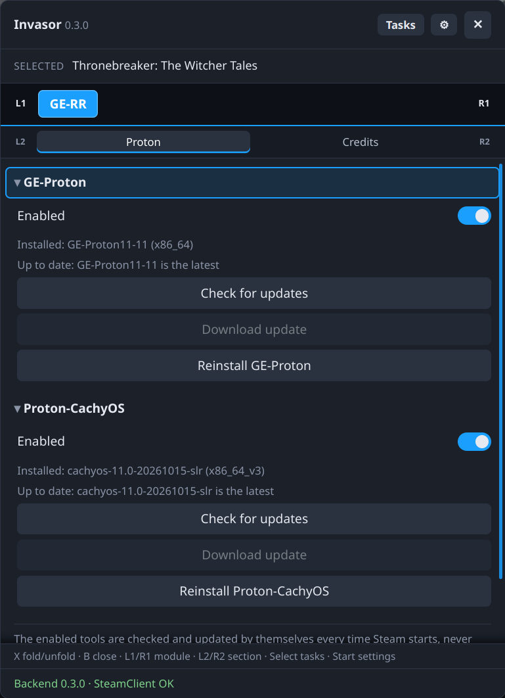

# GE-Proton Rolling Release

A module for [Invasor](../invasor) that keeps the latest [GE-Proton](https://github.com/GloriousEggroll/proton-ge-custom) and [Proton-CachyOS](https://github.com/CachyOS/proton-cachyos) installed, each as a single compatibility tool called **GE-Proton** and **Proton-CachyOS**. Their names never change with the version, so a game set to one of them always runs the newest one: no more picking a new version in each game after every release.

Each tool has its own **Enabled** switch: GE-Proton is enabled by default, Proton-CachyOS isn't. Only the enabled tools are checked and updated. Enabling one checks it right away; disabling it deletes nothing, it's just not updated anymore. The switches are also in ⚙ Settings.

- **When:** every time Steam starts or restarts, one enabled tool after the other (also when switching between Desktop and Game Mode), and when Invasor starts with Steam already running. If there's no network yet, it tries again for a minute. Never while a game is running: the automatic update waits until the game stops (and pauses if a game starts during the download), and the Download/Reinstall buttons are disabled meanwhile.
- **What it downloads:** the latest release from each tool's official GitHub page, built for this machine (detected automatically): GE-Proton `x86_64` or `aarch64`; Proton-CachyOS `x86_64_v3` if the CPU supports it (the Steam Deck does), otherwise `x86_64`, or `arm64`.
- **Checks:** the download must match the release's `.sha512sum` (or GitHub's sha256 digest if that file can't be read); nothing unverified is installed. It checks free space first. The archive is unpacked by Invasor's core (`ctx.archive`): nothing may land outside its folder, only links that stay inside are kept (Proton has many), and there are limits on files and bytes.
- **Where:** `compatibilitytools.d/GE-Proton` and `compatibilitytools.d/proton-cachyos` in Steam's folder (`~/.local/share/Steam` on a Steam Deck; found by Invasor's core). The new version is fully downloaded and extracted before it replaces the old one in a single rename, so a failed update leaves the installed tool untouched. A Proton-CachyOS already installed by hand in `proton-cachyos` is recognised by its version and only replaced when a newer one comes out.
- **Notifications:** Steam shows one when a download starts and another when it's installed. The download also appears in Invasor's Tasks panel (Select), with its progress. Steam loads compatibility tools only when it starts: **restart Steam** to use the new version.

## The tab (Library only, not in Quick Access)
Two sections, folded at first (X unfolds them): **GE-Proton** and **Proton-CachyOS**. Each one has:
- **Enabled:** whether this tool is kept up to date. The buttons below only work while it's on.
- **Check for updates:** asks GitHub for the latest version and says whether it's newer than the installed one.
- **Download update:** enabled when a newer version was found. Restarting Steam does the same.
- **Reinstall:** downloads the latest version again and replaces the installed one, even if it's the same (e.g. to repair a broken install).

The **Credits** sub-tab says who makes GE-Proton and Proton-CachyOS.

## Uninstalling
Uninstalling the module keeps GE-Proton and Proton-CachyOS, so games set to them keep working. **If you also choose to delete the module's data, GE-Proton is deleted too, and Proton-CachyOS if this module installed it** (one installed by hand is kept). Disabling the module, or a tool's switch, deletes nothing.

## Screenshots

<p align="center">
  
</p>

## Requirements
Invasor 0.3.0 or newer (`min_core`): it uses `ctx.archive` to unpack and put the tools in place and `ctx.paths` to find Steam's folder.

## Coming from GE-RR 0.2
- GE-Proton keeps being updated as before; Proton-CachyOS stays off until you enable it.
- The download notifications come from Invasor's Tasks panel, so they are no longer shown twice.

## Coming from `ge-proton-rr.sh`
This module does what `ge-proton-rr.sh --no-gui` did, and recognises the GE-Proton it installed (no new download). Stop that script from running too: remove its autostart entry (`ge-proton-rr.sh --uninstall`) or whatever runs it. Unlike the script, the module doesn't update itself.

## Build, test and install
With the core checked out next to this repository (`../invasor`):

```sh
python3 ../invasor/tools/pack_module.py ge-rr       # build, check, tests -> ge-rr-<version>.zip
python3 ../invasor/tools/install_module.py ge-rr    # or install that zip from ⚙ Settings › Install module
```

## Credits
GE-Proton is by GloriousEggroll and its contributors, and Proton-CachyOS by the CachyOS team and its contributors; both are based on Valve's Proton, under their own licenses. GE-RR only downloads them from their official releases. GE-RR is not affiliated with GE-Proton, GloriousEggroll or CachyOS. Please don't report problems with this module to them.

## License
[GNU General Public License v3.0 or later](LICENSE) (GPL-3.0-or-later).
